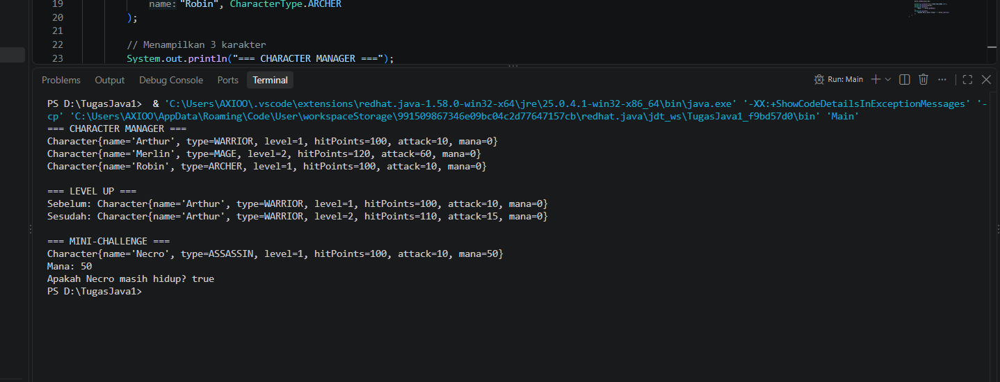

# Character Manager — TP3 (Java Visual SIH-6406)

## Deskripsi Project

Character Manager adalah program sederhana yang dibuat menggunakan bahasa pemrograman Java. Program ini digunakan untuk membuat dan menampilkan data karakter game, seperti nama, tipe karakter, level, HP, attack, dan mana. Program ini juga memiliki fitur level up dan pengecekan apakah karakter masih hidup menggunakan method `isAlive()`.

## Screenshot Output Program

Berikut adalah screenshot hasil program Character Manager yang dijalankan melalui terminal.



## Struktur Folder Project

```text
CharacterManager/
├── src/
│   ├── Main.java
│   └── com/
│       └── unpri/
│           └── charactermanager/
│               └── model/
│                   ├── Character.java
│                   └── CharacterType.java
├── screenshots/
│   └── output.png
└── README.md
```
https://docs.google.com/document/d/17okFJSZr12ccxIjzs19DCV5QB-vryvHZuqznc5sjbmk/edit?usp=sharing